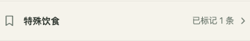
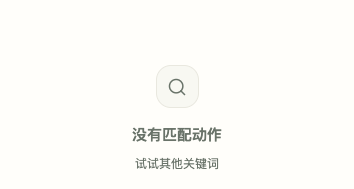
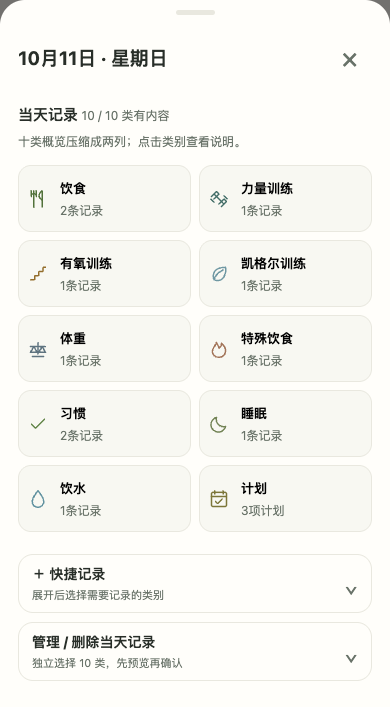
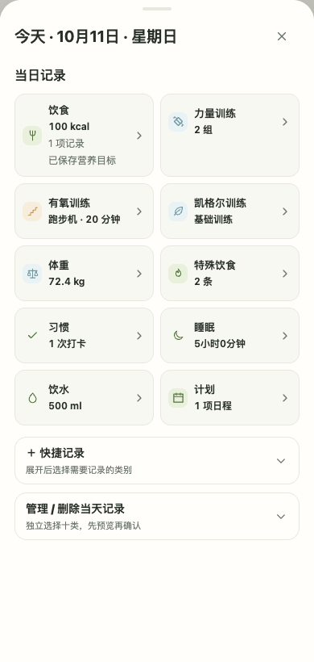
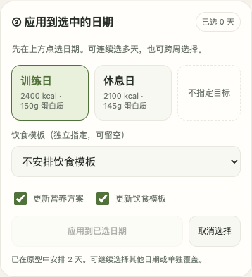
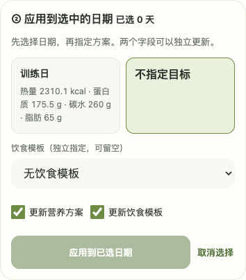

# 390px /100% /浅色：批准原型与实现候选

左侧批准HTML实际运行，右侧相同Chromium/视口/主题的生产代码候选；独立合成业务记录。原型文件未修改。此处为提交前证据；部署身份/线上交互证据见最新开发报告。必要差异见[核对说明](../../COMBINED_HANDOFF_2026_10_11.md)。

|组件|批准原型|真实代码候选|
|---|---|---|
|A 特殊饮食入口|||
|B 模板动作无匹配|||
|C 日期详情|||
|D 独立营养/饮食分配|||
