# v0.4 原型与本地候选原图

原始浏览器PNG，未缩放或改写图像；左为批准原型，右为本地候选。同视口、主题及字体倍率。原型的演示日期/食物/数值不复制到产品。原型100%部分字段使用14px；产品编辑输入遵守16px下限。200%原型使用运行时字体压力覆盖，原HTML不改字节；产品允许高度增长，保留全部文字。

正式Pages图及最终构建身份在正式回执附件，此处不冒充线上截图。

## dark · day-count-11

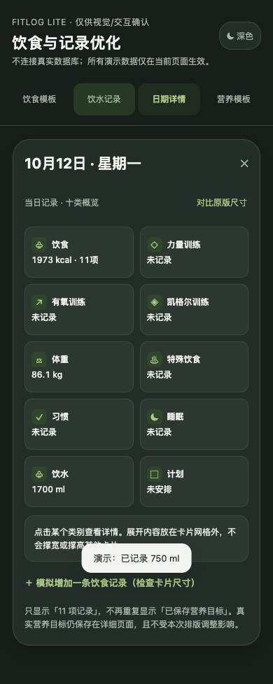
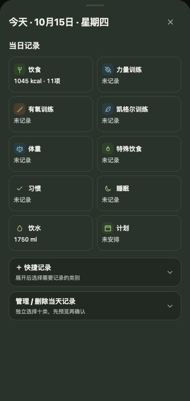

## dark · day-template

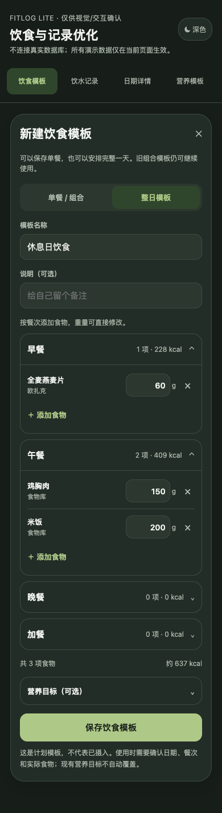
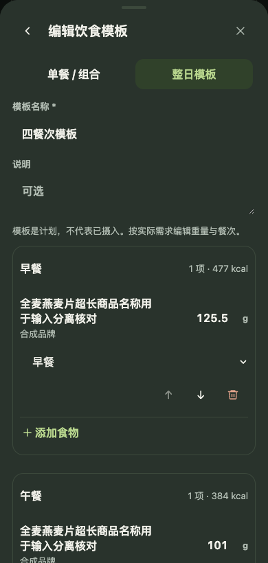

## dark · grams-edited

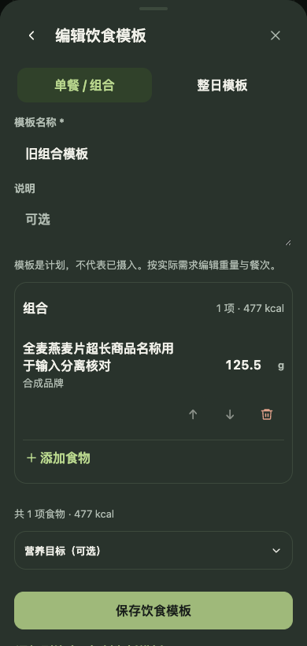

## dark · strategy-reference-management

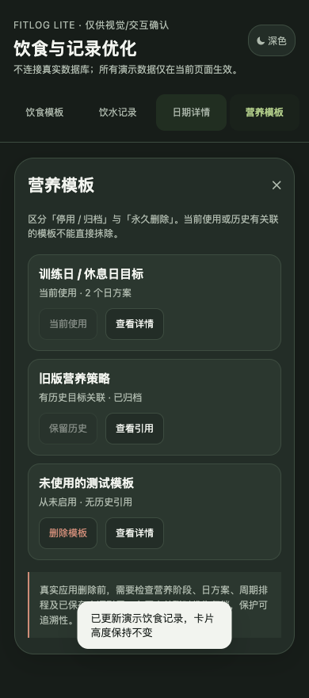
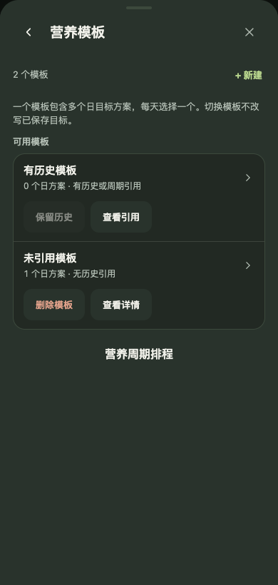

## dark · water-options

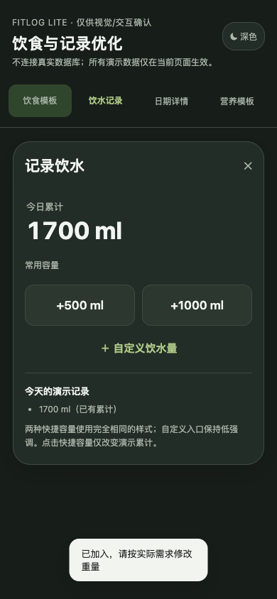
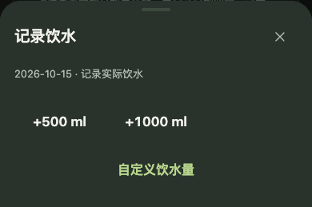

## light · day-count-11

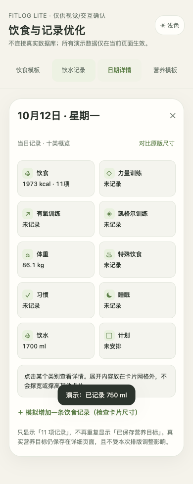
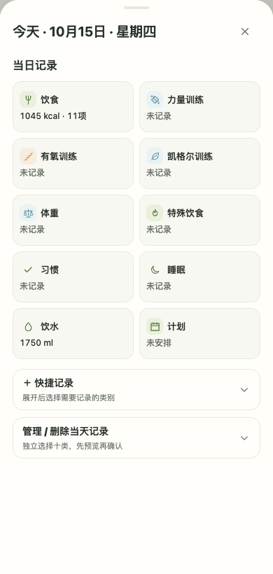

## light · day-template

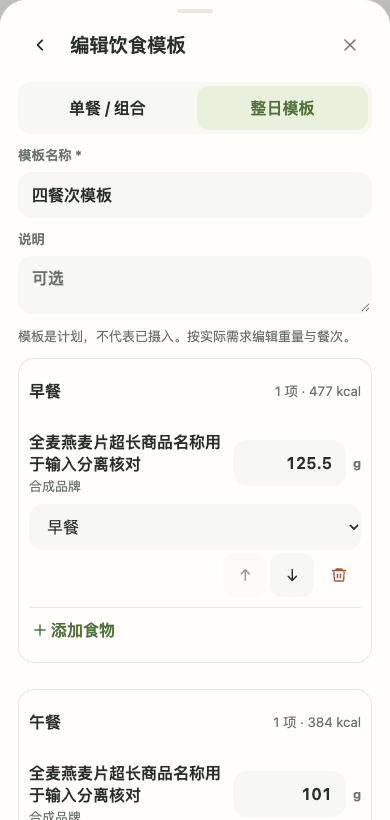

## light · grams-edited

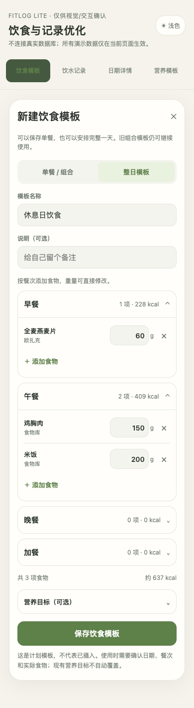
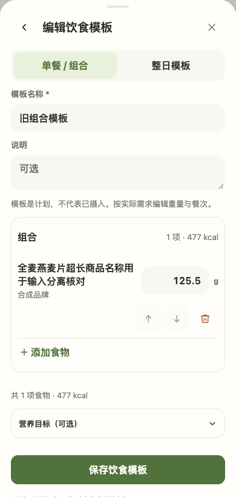

## light · strategy-reference-management

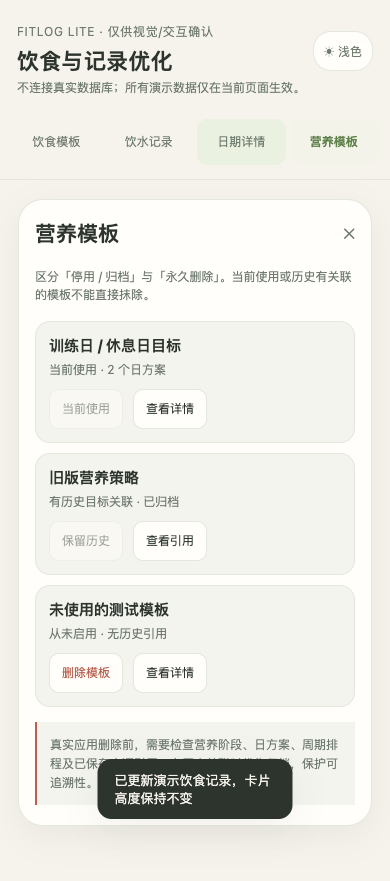
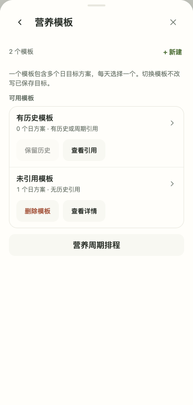

## light · water-options

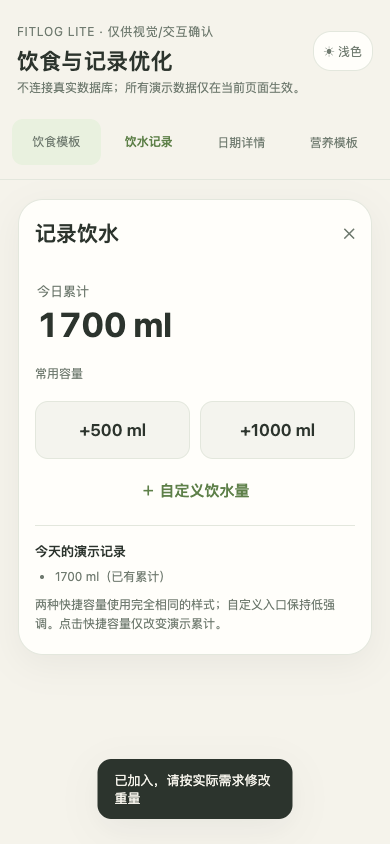
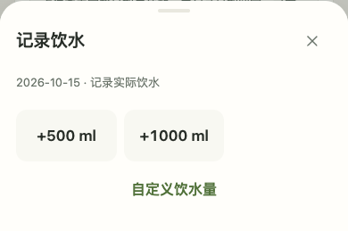
